# Codex Watch

Retrouve tes conversations Codex et Chat sur une montre Wear OS grâce à un relais sur ton PC ou sur un VPS. En Wi-Fi ou en 4G, la montre rejoint le relais choisi ; le relais PC permet aussi le Bluetooth à proximité. L’application permet aussi de parler en Live, de suivre tes tâches et de recevoir des notifications.

Projet indépendant, sans affiliation avec OpenAI ou Samsung. Licence MIT.

Les notifications en veille et en 4G peuvent être configurées avec Firebase : consulte le [guide des notifications](docs/NOTIFICATIONS.md).

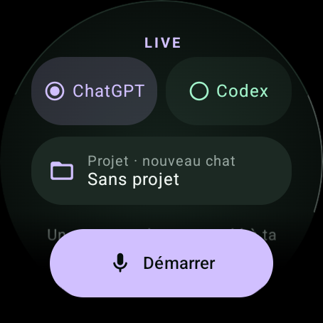

> **Guide avec images sur ton PC :** ouvre [GUIDE-INSTALLATION.html](GUIDE-INSTALLATION.html). Les images s’affichent aussi directement sur GitHub.

## Installation

Choisis ton parcours : **[relais PC Windows](#2-installer-et-configurer-le-relais-sur-le-pc)** ou **[relais VPS Linux](docs/INSTALLER-VPS.md)**. Un seul suffit (mais les deux peuvent fonctionner en parallèle). Installe l’APK sur ta montre Wear OS 3 ou plus récente avec un téléphone Android ; le même APK fonctionne avec les deux relais. Le parcours VPS ne nécessite pas le relais PC.

> **Préversion :** Codex Watch est en cours de validation. L’application n’est pas encore disponible sur le Play Store ; consulte les limites et les essais restant à réaliser dans le [rapport d’état](docs/RAPPORT-ETAT.md).

### 1. Télécharger les applications

Ouvre la [page des releases](https://github.com/evrardt/codex-watch/releases), puis télécharge l’APK 0.12.53 et, si tu utilises Windows, le relais 0.12.53 :

| Sur quel appareil ? | Fichier | Utilité |
| --- | --- | --- |
| PC Windows | [Codex-Watch-Relay-0.12.53-Setup.exe](https://github.com/evrardt/codex-watch/releases/download/v0.12.53/Codex-Watch-Relay-0.12.53-Setup.exe) | Installer le relais qui relie la montre au PC. |
| Téléphone Android | [Codex-Watch-0.12.53.apk](https://github.com/evrardt/codex-watch/releases/download/v0.12.53/Codex-Watch-0.12.53.apk) | Installer Codex Watch sur la montre. |

Installe également :

- [Codex pour PC](https://openai.com/codex/) et connecte-toi à ton compte.
- [Tailscale pour Windows](https://tailscale.com/download/windows) pour rendre le relais accessible hors de ton Wi-Fi.
- [Wear Installer 2 sur Google Play](https://play.google.com/store/apps/details?id=org.freepoc.wearinstaller2), **sur le téléphone Android**. Aucune installation de Wear Installer 2 n’est nécessaire sur la montre.

L’installateur Windows de cette version n’est pas signé par un certificat d’éditeur. Télécharge toujours les fichiers depuis la release officielle du dépôt et vérifie que tu lui fais confiance.

### 2. Installer et configurer le relais sur le PC

1. Ouvre Codex sur le PC, connecte-toi et ouvre au moins une conversation dans un projet.
2. Exécute l’installateur **Codex Watch Relay** téléchargé, puis ouvre l’application.
3. Dans **Connexion**, choisis **Codex sur ce PC**, clique sur **Détecter Codex**, puis coche les projets à rendre accessibles sur la montre. **Tout sélectionner** ne comprend que les dossiers présents.
4. Clique sur **Appliquer**. Tu configureras l’adresse HTTPS à l’étape 4.

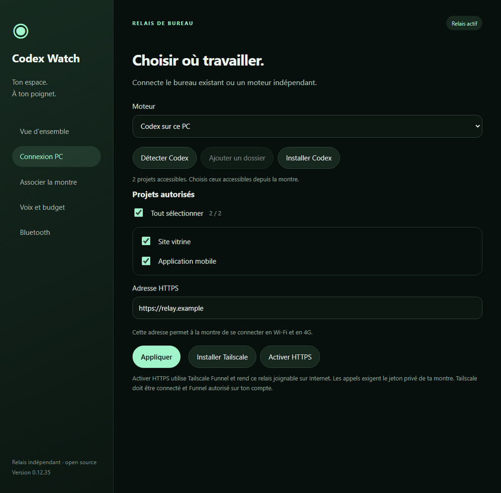

Les captures utilisent des données fictives : utilise toujours les adresses et codes affichés par ton propre relais.

### 3. Installer l’APK sur la montre depuis le téléphone

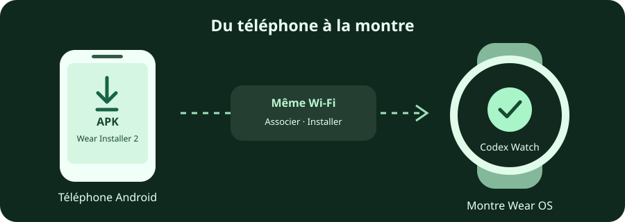

1. Télécharge le fichier `Codex-Watch-<version>.apk` de la release dans le dossier **Téléchargements** du téléphone et installe [Wear Installer 2](https://play.google.com/store/apps/details?id=org.freepoc.wearinstaller2) sur celui-ci.
2. Connecte le téléphone et la montre au **même Wi-Fi**. Sur la montre, active les **options pour les développeurs** : sur une Galaxy Watch, ouvre **Paramètres → À propos de la montre → Informations sur le logiciel**, puis touche plusieurs fois **Version du logiciel**. Sur les autres montres, cherche le **numéro de build** dans les informations système et touche-le plusieurs fois. Les intitulés peuvent varier.
3. Dans **Options pour les développeurs**, active **Débogage ADB** puis **Débogage sans fil**. Ouvre l’écran **Débogage sans fil** et note l’adresse IP qui s’affiche.
4. Ouvre Wear Installer 2 sur le téléphone, saisis l’adresse IP de la montre sur son écran d’accueil et touche **Done**. Si le téléphone est déjà associé pour le débogage, passe à l’étape 6.
5. Dans le menu de Wear Installer 2, choisis **Pair with watch**, puis **Enable**. Sur la montre, touche **Associer un nouvel appareil** : un code à six chiffres et un port d’association s’affichent. Dans la demande de Wear Installer 2, saisis **le code, un espace, puis le port d’association**, et valide avec **Done**. Attends le message de réussite.
6. Reviens à l’écran principal **Débogage sans fil** de la montre. Dans Wear Installer 2, saisis le **port de connexion** indiqué après l’adresse IP. Il est différent du port d’association de l’étape précédente.
7. Dans Wear Installer 2, choisis **Custom APK**, sélectionne le fichier téléchargé, puis touche **Install**. Une fois l’installation terminée, ouvre **Codex Watch** sur la montre. Tu peux maintenant désactiver **Débogage sans fil** et **Débogage ADB**.

Le code Android de cette étape sert uniquement à l’installation. Le code Codex Watch demandé à l’étape 5 est différent. Pour les images et détails de Wear Installer 2, consulte [le guide de son développeur](https://freepoc.org/wear-installer-2-help-page/) (en anglais). Sans téléphone Android, l’[installation depuis un PC avec les outils Android](https://developer.android.com/training/wearables/get-started/debug-wifi) est possible, mais demande des manipulations supplémentaires.

### 4. Activer l’accès à distance

1. Installe [Tailscale sur le PC](https://tailscale.com/download/windows) et connecte-toi.
2. Dans **Connexion** du relais, clique sur **Activer HTTPS**. Si Tailscale demande d’autoriser HTTPS ou Funnel, accepte ou demande à l’administrateur de ton réseau de le faire, puis réessaie si nécessaire.
3. Vérifie que l’adresse HTTPS apparaît, clique sur **Appliquer**, puis vérifie dans **Vue d’ensemble** que le relais est actif et Codex connecté.

**Tailscale Funnel rend l’adresse du relais accessible depuis Internet.** Les fonctions privées exigent le jeton d’association : ne partage ni ce jeton ni le code temporaire. Pour utiliser la montre à distance, le PC et le relais doivent rester allumés et connectés.

### 5. Associer Codex Watch au relais

1. Sur le PC, ouvre **Associer la montre**, puis **Générer le code**. Un code à six chiffres, valable deux minutes et utilisable une fois, s’affiche avec l’adresse HTTPS.
2. Sur la montre, ouvre **Codex Watch → Paramètres → Connexions → Mon PC**. Si un profil existe déjà, touche **Modifier**.
3. Choisis le relais détecté sur le même Wi-Fi ou saisis son adresse HTTPS. Entre le code affiché par le PC, puis touche **Associer** ou valide sur le clavier.
4. Le PC affiche **Association réussie** après confirmation. Si le code expire, génère-en un nouveau.

La page **Associer la montre** indique ensuite **Montre associée** lorsqu’une association a été confirmée avec ce relais. Cette indication ne signifie pas que la montre est actuellement en ligne. Les nouvelles associations apparaissent aussi dans **Montres autorisées** et peuvent être retirées individuellement. Les anciennes associations utilisaient un jeton partagé ; les réassocier ne révoque pas automatiquement cet ancien jeton.

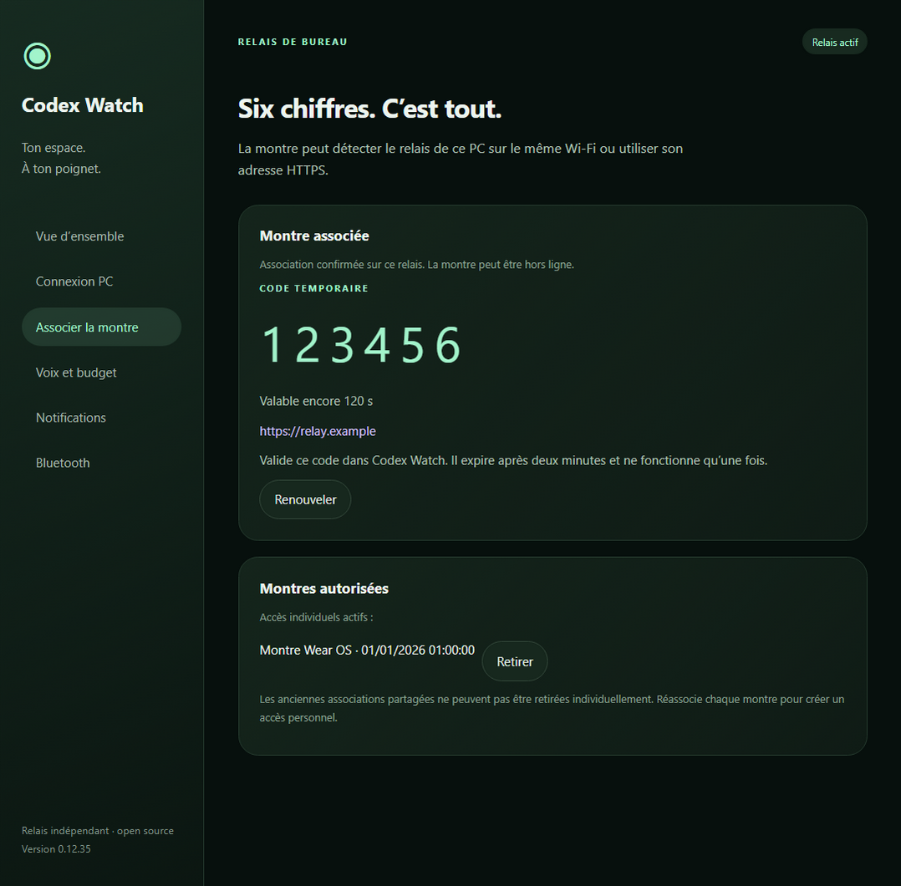

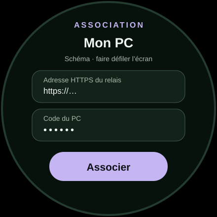

Ce schéma regroupe les champs pour les rendre lisibles ; sur la montre, fais défiler pour les atteindre.

### Connexion Bluetooth à proximité

Après l’association initiale décrite ci-dessus, tu peux relier directement la montre au PC sans Wi-Fi ni 4G sur la montre :

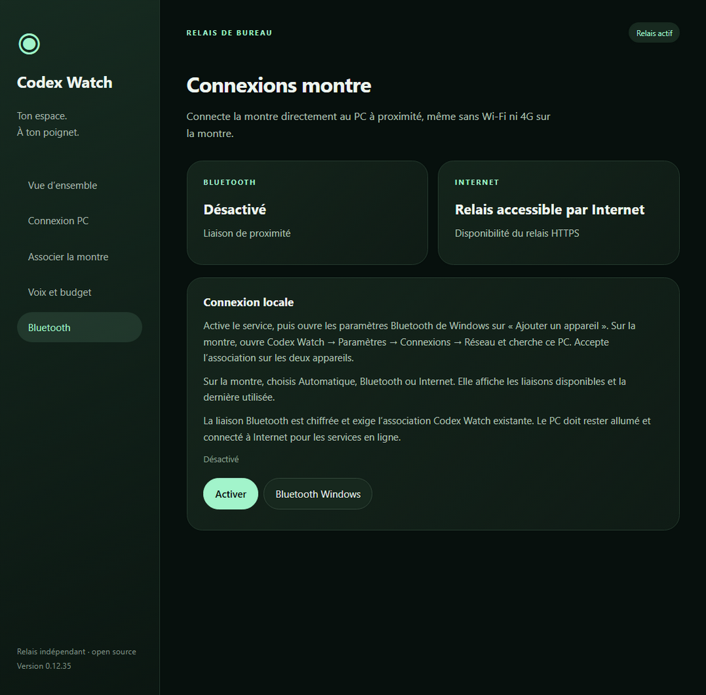

1. Dans **Codex Watch Relay → Bluetooth** sur le PC, active le service. Dans les paramètres Windows, ouvre **Bluetooth et appareils → Ajouter un appareil → Bluetooth** pour rendre le PC détectable pendant l’association.
2. Sur la montre, ouvre **Codex Watch → Paramètres → Connexions → Réseau**, autorise les appareils à proximité, puis touche **Chercher** et choisis ton PC.
3. Accepte l’association Bluetooth sur les deux appareils si un code apparaît. La montre indique **Connecté au relais** après vérification ; le relais PC affiche **Montre connectée en Bluetooth** lorsque la liaison est établie. La montre et le PC doivent rester à portée Bluetooth.
4. Dans ce même écran, choisis **Automatique** pour utiliser les deux liaisons, **Bluetooth** pour rester en proximité ou **Internet** pour utiliser le Wi-Fi ou la 4G. Ton association Bluetooth reste enregistrée lorsque tu choisis Internet.

La montre affiche la disponibilité de chaque liaison et la dernière utilisée. Sur le PC, la page **Bluetooth** indique si une liaison Bluetooth est établie et si le relais HTTPS est accessible depuis le PC ; la disponibilité Internet de la montre est vérifiée sur la montre elle-même. En mode automatique, l’application tente l’autre liaison si une connexion échoue. Les demandes dont la réception est incertaine ne sont pas renvoyées automatiquement lorsqu’elles risqueraient de créer un doublon.

Pendant un Live, une reconnexion rapide peut reprendre la même session. Le micro est brièvement en pause pendant la bascule ; une coupure trop longue peut mettre fin à l’appel.

### Utiliser un VPS sans relais PC

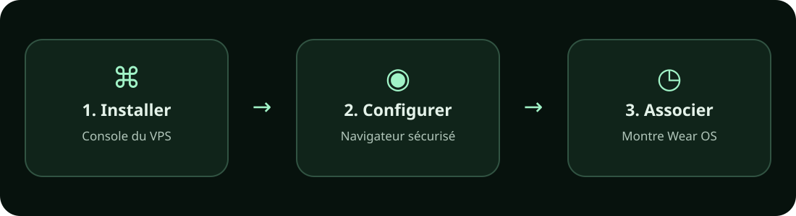

Le relais VPS s’installe sur Linux, puis se configure depuis un navigateur : connexion Codex, clé API pour le Chat et code d’association de la montre. Le PC et son application relais ne sont pas nécessaires. Consulte le [guide VPS pas à pas](docs/INSTALLER-VPS.md).

Sur la montre, choisis **Lier serveur** lors du premier démarrage, ou **Paramètres → Connexions → Mon serveur** si elle est déjà associée. Une seule connexion suffit : la montre la sélectionne automatiquement. Si tu configures aussi un relais PC, un bouton en bas de l’accueil permet de passer de l’un à l’autre.

Le Chat du VPS utilise l’API OpenAI et conserve son propre historique sur le serveur : les conversations, projets et plugins du site ChatGPT ne sont pas importés. Les appels consomment les crédits de l’organisation API liée à la clé, puis peuvent être facturés selon ta configuration OpenAI. Vérifie le solde et les limites sur [OpenAI Platform](https://platform.openai.com/). Le budget audio et le Live sont configurés séparément.

Certains abonnements ChatGPT Business donnent droit à des crédits API à activer sur une organisation API ; ils sont mutualisés pour l’espace de travail, et une nouvelle clé ou un autre utilisateur ne crée pas de nouveau solde. Les conditions, montants et échéances figurent dans la [documentation OpenAI](https://developers.openai.com/api/docs/guides/chatgpt-api-credits). Les limites de Codex connecté et les crédits API sont distincts.

L’accès aux services du serveur dépend des droits et de la configuration de son instance Codex ; l’association de la montre ne donne pas automatiquement des droits administrateur. Les actions sensibles exigent un dispositif de validation adapté.

En Bluetooth, les versions compatibles du relais et de la montre utilisent Opus pour alléger fortement la voix du Live. La voix reste celle de l’agent, avec une légère compression de sa qualité. La montre privilégie un décodage local plus rapide et revient au décodeur Android si nécessaire. Son tampon de lecture est un peu plus grand en mode Bluetooth ou automatique, ce qui ajoute un léger délai pour mieux absorber les variations de débit. Si Opus n’est pas disponible, les appareils reviennent à la compression sans perte ou au format précédent. Reste à proximité du PC ; si le son reste irrégulier, utilise le mode Internet lorsque le Wi‑Fi ou la 4G est disponible. Le Live continue d’utiliser l’API OpenAI : la compression entre le PC et la montre ne supprime pas sa facturation.

La liaison Bluetooth est authentifiée et chiffrée et utilise le jeton de ton association Codex Watch. Les notifications directes gardent une connexion en arrière-plan ; la veille de la montre peut les retarder. Le PC doit rester allumé et disposer d’Internet pour les services Codex, ChatGPT et Live en ligne. Les performances audio peuvent varier avec la portée et la qualité du signal.

### 6. Utiliser l’application

- **Codex et ChatGPT :** choisis une entrée sur l’accueil, puis un projet et une conversation.
- **Questions de Codex :** les questions et accords pris en charge apparaissent dans la conversation concernée. Dans les listes, une demande en attente est signalée ; une notification ouvre également la conversation. Après l’envoi, la montre affiche « Envoi… » jusqu’à confirmation. En mode « Codex sur ce PC », certains formulaires de question du chat actuellement ouvert sur le PC peuvent être remplis depuis la montre. Si l’envoi ne peut pas être confirmé, ou si le formulaire a changé ou contient déjà un brouillon sur le PC, vérifie la conversation sur le PC avant de réessayer. Cette fonction Windows est expérimentale et ne reconnaît pas tous les formulaires ; les approbations sensibles restent à traiter sur le PC.
- **État des conversations :** dans les listes, un indicateur animé signale une tâche en cours, une coche indique une tâche terminée et une icône de question signale une demande qui attend ta réponse. Les propositions et leurs descriptions s’affichent en entier ; choisis-en une ou saisis une réponse personnelle directement dans la conversation.
- **Envoi et historique :** un retour tactile et « Envoi… » confirment l’appui ; attends ensuite la confirmation avant de quitter. Pour les conversations volumineuses du PC, l’historique est chargé par pages : utilise **Précédents** pour retrouver les échanges antérieurs.
- **Notifications :** dans **Paramètres → Notifications** sur la montre, touche **Activer**, autorise les notifications et essaie **Tester une alerte** sur chaque relais. Les alertes directes fonctionnent sans compte Firebase. FCM est facultatif et demande actuellement une configuration avancée séparée côté relais : son installation n’est pas encore guidée par l’interface. Une fois configuré avec un compte de service, les jetons de courte durée sont renouvelés automatiquement, sans connexion Google quotidienne. Si plusieurs relais sont associés, ou si l’unique liaison exige le Bluetooth ou n’a pas encore confirmé FCM, une notification permanente maintient l’écoute directe ; elle peut consommer davantage de batterie et la veille profonde peut retarder les alertes.
- **Lire les réponses avec Phonon :** dans le relais PC, ouvre **Voix et budget** et sélectionne **Phonon**. Accepte les [conditions du modèle multilingue](https://huggingface.co/gradium/phonon-40m-multilingual), puis crée si besoin un [jeton Hugging Face de lecture](https://huggingface.co/settings/tokens). Saisis-le dans le relais et clique sur **Installer Phonon**. Si tu es déjà connecté à Hugging Face sur le PC, le champ peut rester vide. Le jeton sert au téléchargement et n’est pas conservé par Codex Watch. Sur le PC ou la montre, sélectionne **Phonon** dans **Voix et budget** : le choix est enregistré immédiatement et partagé. Pour changer de voix, utilise le sélecteur **Voix** sur le PC ou **Réglages Phonon → Voix → langue → voix** sur la montre : le choix est partagé. Noémie est proposée par défaut. Les voix sont téléchargées une fois, puis utilisées en local. Le modèle prend en charge le français, l’anglais, l’allemand, l’espagnol et le portugais ; la langue principale est détectée au mieux sur les passages assez longs. Les phrases courtes ou mélangées peuvent conserver l’accent de la voix choisie. Le modèle est gratuit en local pour un usage non commercial ; si Phonon est indisponible, la voix de la montre prend le relais. Chaque relais possède sa propre installation de Phonon. Si la montre ne peut pas vérifier son état, rétablis d’abord la connexion au relais sélectionné ; cela ne signifie pas que le modèle a été supprimé.

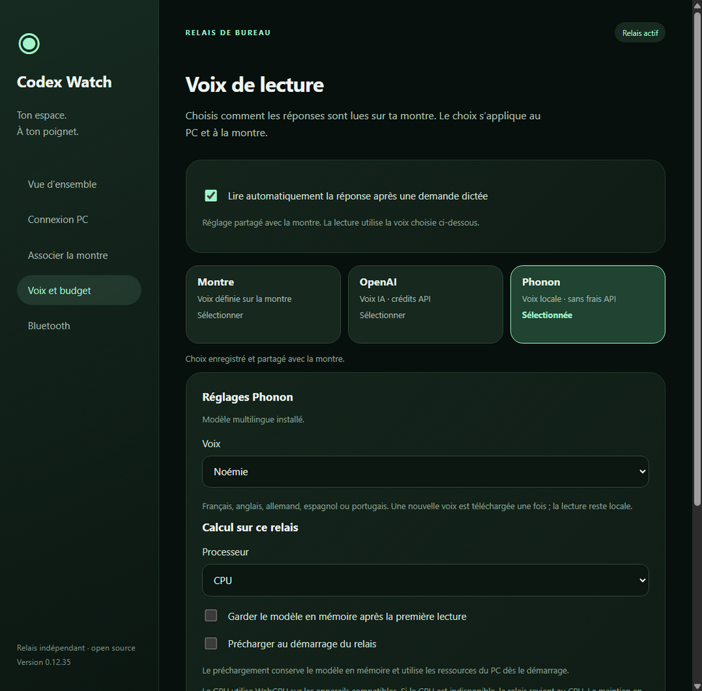

- **Calcul Phonon :** dans les réglages Phonon du relais PC, choisis **CPU**, **Automatique** ou **GPU · WebGPU**, puis enregistre. Le GPU peut fonctionner avec différents fabricants si WebGPU est disponible ; sinon le relais revient au CPU et l’indique. Active **Garder le modèle en mémoire** pour le réutiliser après la première lecture, au prix d’une occupation de mémoire prolongée. **Précharger au démarrage du relais** charge et conserve le modèle dès son lancement ; cette option utilise de la mémoire même avant une lecture. **Tester le calcul** affiche le matériel réellement utilisé. Un changement de langue peut nécessiter de recharger le modèle.

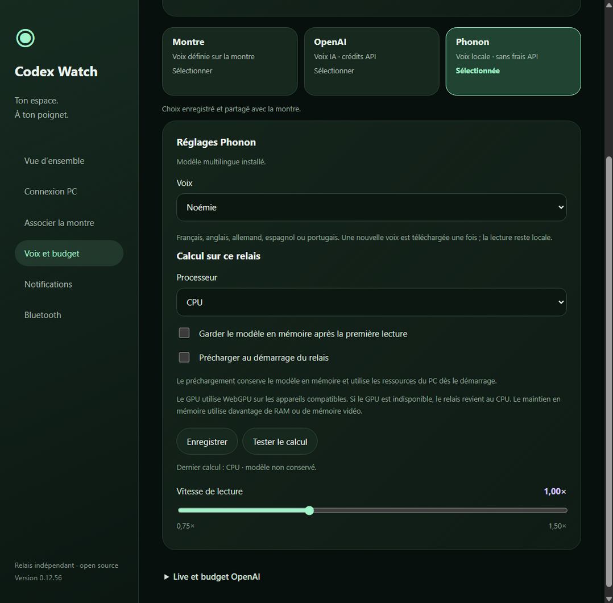

- **Phonon sur un serveur Linux avec GPU NVIDIA :** installe d’abord Phonon dans l’administration du serveur. Pour utiliser CUDA, le serveur doit disposer de Linux x86-64, d’un GPU et d’un pilote NVIDIA compatibles, du [toolkit CUDA](https://developer.nvidia.com/cuda-downloads) et de [Rust avec Cargo](https://www.rust-lang.org/tools/install). Dans **Voix Phonon locale**, saisis à nouveau le jeton Hugging Face et clique sur **Installer CUDA** : la compilation et le téléchargement du modèle peuvent prendre plusieurs minutes et utiliser plusieurs Go d’espace. Ensuite, choisis **GPU NVIDIA · CUDA** dans **Calcul**, puis **Enregistrer**. L’état indique le calcul utilisé pour la dernière lecture ; si CUDA échoue, le relais revient au CPU. Sur Linux, le modèle est rechargé à chaque lecture. Les GPU AMD et Intel ne sont pas encore pris en charge par cette installation CUDA.

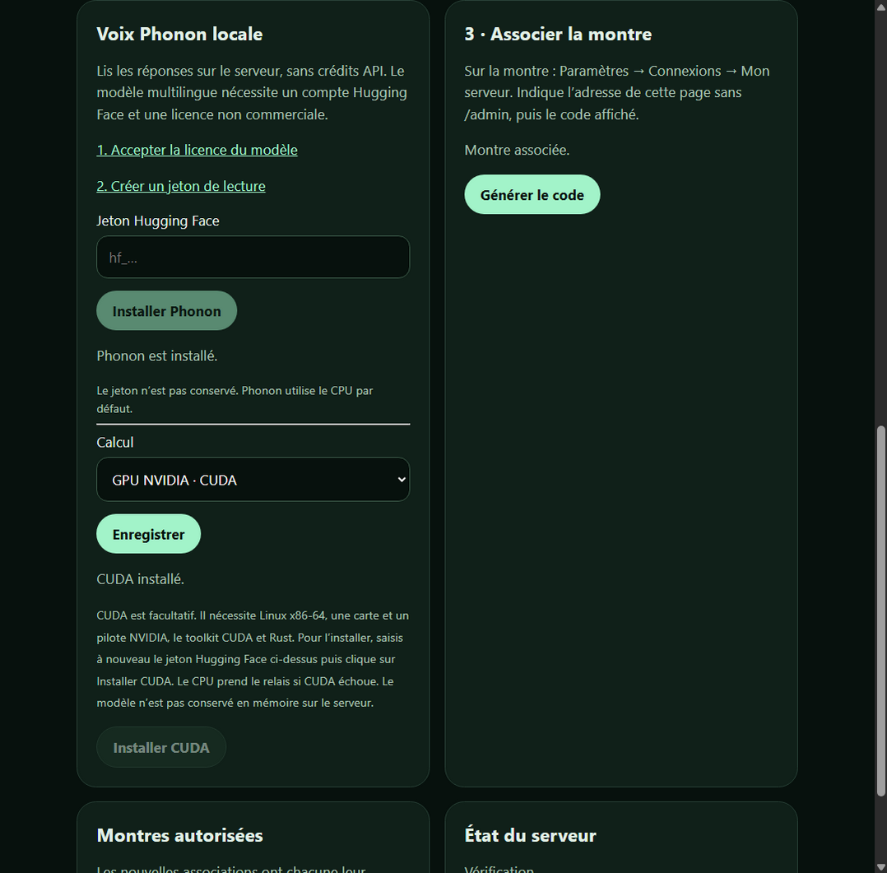

- **Lecture de réponses longues :** la montre prépare le passage suivant pendant la lecture. Avec OpenAI, ce passage peut être facturé même si tu arrêtes ensuite l’écoute.
- **Live :** crée si besoin une [clé API OpenAI](https://platform.openai.com/api-keys), puis enregistre-la dans **Voix et budget → Live et budget OpenAI** sur le PC. Règle le plafond mensuel en dollars sur le PC ou dans **Budget Live** sur la montre. Le Live utilise toujours l’API OpenAI, même si Phonon est sélectionné pour les réponses ; elle est facturée séparément de l’abonnement ChatGPT ; le budget local ne remplace pas le suivi de facturation OpenAI.

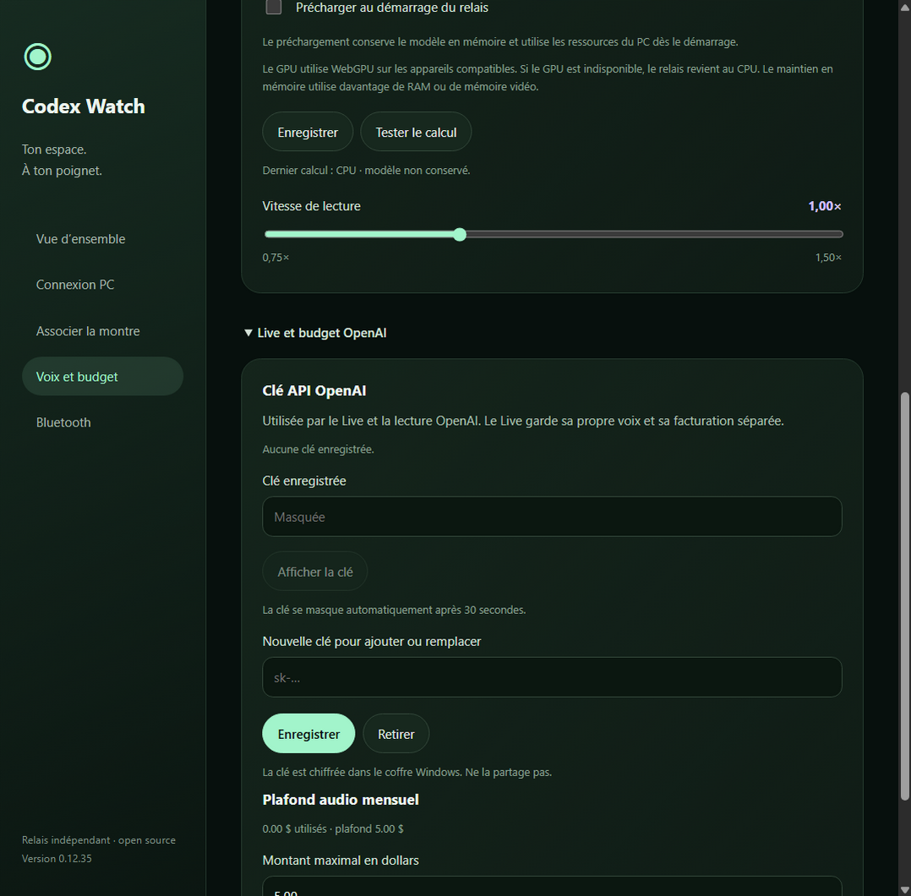

Après une demande de nouvelle conversation, la montre affiche ton message et indique que la création doit encore être confirmée. Elle ouvre le chat dès que le relais peut l’identifier. Une acceptation par le PC ne garantit pas que ChatGPT a créé le chat ou reçu le message : si la création tarde ou que ChatGPT limite la lecture, vérifie d’abord la liste des conversations avant de renvoyer. La liste peut elle aussi être temporairement indisponible en cas de limitation.

Dans une conversation **Codex**, utilise **Modèle** ou **Réflexion** en bas du chat pour choisir parmi les options disponibles sur le relais. Sélectionne d’abord un modèle pour régler sa réflexion. Ce choix concerne ce chat et ses prochaines demandes, y compris celles transmises en Live. **Réglage général** reprend les paramètres de la montre ; **Du PC** ou **Du serveur** reprend les réglages de la conversation sur le moteur associé. Un changement ne modifie pas une réponse déjà en cours. Pour ChatGPT, le choix reste sur le PC : l’intégration ne permet pas encore de le changer depuis la montre.

Le relais poursuit la recherche d’une création en attente pendant que la montre est en veille. Au retour sur l’écran de suivi, la montre ouvre le chat dès que son identité a été confirmée. Si ChatGPT impose une limite temporaire, la recherche reprend après le délai nécessaire.

Pendant la création, le relais rapproche temporairement ses vérifications pour ouvrir le chat plus vite, sans accélérer la surveillance habituelle des autres conversations. Le temps de création et de réponse dépend aussi de ChatGPT.

Pour retrouver un nouveau chat, le relais peut utiliser la liste récente du PC, puis vérifier son premier message et son projet. Si cette liste ne couvre pas suffisamment la période ou si plusieurs chats correspondent, il ne choisit pas au hasard.

Si cette liste tarde à répondre, le relais essaie l’historique disponible et reprend ses vérifications ensuite, tout en respectant les éventuelles limites temporaires du service.

Pour réduire les lectures répétées de ChatGPT, le relais espace la surveillance des conversations inactives. Une notification ChatGPT peut alors arriver avec un délai allant jusqu’à deux minutes ; les échanges récemment lancés depuis la montre sont vérifiés plus souvent.

Les conversations restent actualisées automatiquement ; lorsque leur contenu ne change pas, le relais et la montre évitent de retransmettre les mêmes messages.

Dans une conversation, **Répondre** ouvre le clavier et **Dicter** prépare un brouillon avec la reconnaissance vocale de la montre. Utilise **Ajouter une dictée** autant de fois que nécessaire, corrige le texte puis touche **Envoyer**. Après une demande dictée, la réponse est lue automatiquement lorsque la conversation est ouverte. Active ou désactive **Lecture automatique** dans **Voix de lecture**, sur la montre ou dans le relais PC : ce réglage est partagé. Pour ces réponses, la notification de fin reste visible sans son uniquement si l’application est ouverte et que la lecture commence effectivement. Sinon, elle reste sonore ; si la montre interrompt l’application pendant la vérification, un secours affiche l’alerte sonore, éventuellement avec un délai lié à la veille Android. La reconnaissance dépend du service installé sur la montre ; elle ne réutilise pas la dictée intégrée de Codex sur le PC.

Sur la montre, touche **Live** depuis l’accueil, choisis le contexte et le projet puis **Démarrer**. Pour utiliser une conversation existante, ouvre-la d’abord et touche **Live**. L’entrée **Codex Watch Live** peut être associée à un bouton si la montre le permet.

Avant l’appel, **Plugins Codex** permet de demander l’utilisation de plugins disponibles sur le relais pour les demandes envoyées à Codex ; les sélectionner choisit le contexte Codex. Dans la liste, **Plugin · consignes** désigne un plugin avec une procédure, et **Application** une source ou un outil. Pour une intervention de fond, le Live retient la réponse vocale jusqu’à la transmission à Codex, puis attend son résultat. Si la délégation vocale tarde, le relais peut transmettre une fois la demande transcrite ; une délégation tardive pour la même intervention est ignorée. En cas de réception incertaine, vérifie le chat avant de renvoyer. Il transmet ensuite le résultat au modèle vocal en lui demandant de préserver le raisonnement et le ton ; les liens restent consultables dans le chat. Pendant le travail, tu peux demander où il en est ou demander à être prévenu : la conversation continue et le relais attend le résultat. Codex doit confirmer que le plugin est accessible et a réellement été utilisé ; la sélection ne l’installe pas et le relais ne peut pas encore garantir une mention structurée « @ ». Le relais ne peut pas non plus lister ni sélectionner les applications et GPTs propres au compte ChatGPT. Cette fonction nécessite une version compatible du relais.

### Besoin d’aide ?

| Situation | Solution |
| --- | --- |
| Wear Installer 2 ne trouve pas la montre | Vérifie le même Wi-Fi et le débogage sans fil. Consulte [l’aide du développeur](https://freepoc.org/wear-installer-2-help-page/), notamment si un VPN est actif. |
| Le code d’installation ne fonctionne pas | Saisis le code Android, suivi d’un espace et du port d’association ; utilise ensuite le port de connexion affiché sur l’écran principal de la montre. |
| L’APK refuse la mise à jour | Une version précédente signée avec une autre clé, par exemple une version de développement, ne peut pas être mise à jour directement. Sa désinstallation efface ses données : sauvegarde-les d’abord si nécessaire. |
| Le code Codex Watch expire | Génère un nouveau code sur le PC, vérifie l’adresse HTTPS et valide sur la montre. Il est différent du code Android. |
| Le relais est indisponible | Vérifie que le PC est allumé, que le relais indique **Relais actif** et que l’adresse HTTPS est joignable. Fermer sa fenêtre le laisse actif ; **Quitter et arrêter le relais** le coupe. |
| Un projet manque | Vérifie que son dossier existe sur le PC, puis relance **Détecter Codex**. |
| Phonon ne s’installe pas | Vérifie les conditions acceptées, le jeton de lecture et la connexion Internet sur le PC. Le modèle multilingue est réservé aux usages non commerciaux. |
| Le Live ne démarre pas | Vérifie la clé, les crédits API et le budget dans **Voix et budget**, ainsi que l’autorisation du microphone. |
| Les alertes n’arrivent pas | Vérifie l’autorisation des notifications et la disponibilité du relais. FCM nécessite sa propre configuration. |

## En savoir plus

La Galaxy Watch 7 LTE est la première montre testée ; le projet reste en cours de validation pour une diffusion générale. L’utilisation d’un serveur autonome, la construction depuis les sources et les détails techniques se trouvent dans le [guide avancé](docs/INSTALLATION-AVANCEE.md). Voir aussi [Contribuer](CONTRIBUTING.md), [Confidentialité](docs/PRIVACY.md), [Sécurité](SECURITY.md) et [Changements](CHANGELOG.md).

La vitesse de lecture est réglable avec un curseur de 0,75× à 1,50×, séparément pour la voix de la montre, OpenAI et Phonon, depuis **Voix et budget**, sur la montre ou le relais. Sur la montre, touche **Enregistrer** après avoir déplacé le curseur. Elle ne modifie pas le Live. Les liens sont lus par leur intitulé, sans dicter leur destination.

