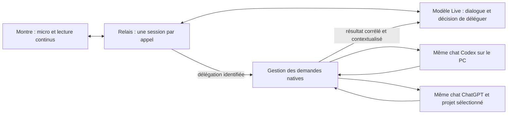

# Audit du Live et du relais

Audit du 8 novembre 2026, après l’essai utilisateur de la version 0.10.0. Ce document distingue les faits observés, les défauts établis par le code et les limites encore ouvertes. Il ne constitue pas une certification de fonctionnement parfait.

## Diagnostic du dernier essai

Le journal de l’appel concerné montre **un dialogue vocal sans aucune soumission à un chat natif**. Il n’y a pas eu création de plusieurs chats ou alternance entre plusieurs tâches du PC dans cet appel. Le journal contient notamment une réponse supplémentaire « Tranquille aussi » après une réponse déjà donnée à « Comment ça va », sans nouvelle intervention entre les deux.

Le code 0.10.0 avait deux autorités concurrentes :

1. Le modèle Live, qui écoute, répond et demande une délégation lorsque nécessaire.
2. Des temporisateurs déclenchés par la transcription : après un silence, ils injectaient une consigne au modèle pour obtenir une réponse, puis pouvaient soumettre le texte au moteur natif si aucune réponse n’était détectée assez vite.

Ce second circuit pouvait réactiver un ancien sujet ou lancer une demande alors que le modèle vocal avait déjà engagé sa réponse. **Son existence est établie par le code ; son rôle exact dans chaque répétition passée reste une hypothèse**, car les anciennes sessions ne conservaient pas la chronologie de ces commandes de contrôle. Le correctif ajoute cette instrumentation au lieu de déduire les futurs incidents du seul texte final.

Autre défaut : une consigne reçue pendant une tâche pouvait attendre dans la file, puis absorber une autre intervention survenue entre-temps. Les résultats tardifs pouvaient également demander une prise de parole alors que l’utilisateur avait changé de sujet. Ces courses nécessitent une gestion explicite de l’identité des demandes.

Un essai réel supplémentaire a montré une troisième source : avec zéro relance et zéro délégation, le modèle a brièvement récité un ancien résultat arithmétique du chat de test au début d’une nouvelle demande. L’historique natif était présenté comme une succession de tours utilisateur/assistant. Ajouter une frontière finale et une instruction de ne pas réciter n’a pas suffi : un deuxième essai a reproduit le défaut. Le candidat final représente donc ces messages comme **une archive textuelle étiquetée**, en conservant leurs rôles dans les données, plutôt que comme des tours actifs du nouvel appel. Le troisième essai de 75 secondes, avec quatre interruptions, n’a plus récité l’ancien calcul. Cela établit une amélioration sur ce scénario, pas une garantie absolue contre toute répétition du modèle.

## Architecture retenue

Le flux microphone reste ouvert pendant la lecture. Le modèle peut prendre la parole pendant une intervention utilisateur. Une nouvelle prise de parole soutenue de l’utilisateur peut interrompre la lecture du bot. Une interruption vocale arrête la parole, **pas automatiquement la tâche du PC**. Annuler une tâche ou approuver une opération reste une action distincte.

La transcription sert de contexte et de sous-titres. Un silence, un fragment transcrit ou une commande acoustique de fin de phrase **ne déclenche jamais seul une tâche ni une nouvelle réponse**. La délégation sémantique du modèle est l’unique entrée automatique du circuit natif. Le relais rassemble ensuite la consigne, son contexte oral et sa destination, puis applique l’idempotence existante.

Une réponse native conserve son identifiant de délégation, sa clé de soumission et son chat. Une correction ne doit ni rejouer la demande initiale ni créer une copie du chat. Une réception incertaine n’est jamais renvoyée automatiquement. Un résultat ancien est rendu au modèle comme information silencieuse et explicitement étiquetée, plutôt que comme une nouvelle obligation de parler.

Ce partage des responsabilités suit la [documentation officielle sur la délégation Live](https://developers.openai.com/api/docs/guides/live-delegation). Le modèle vocal et le moteur natif travaillent simultanément ; la fin d’une tâche native ne prouve pas que sa réponse a été entendue.

## Corrections du candidat 0.11.0

| Défaut établi | Correction | Vérification |
|---|---|---|
| Relances après silence en concurrence avec le modèle | Suppression des temporisateurs de réponse et de soumission ; ancienne commande `utterance_end` ignorée | Plusieurs tours de dialogue et silences : aucune soumission ni consigne de relance |
| Ancien résultat du chat interprété comme une réponse à redire | Archive textuelle avec rôles conservés dans les données, séparée des tours du nouvel appel | Deux variantes insuffisantes détectées par les essais ; scénario final sans reprise du calcul historique |
| Deux chemins d’interruption : détection locale puis « stop » transcrit | Regroupement des commandes concernant une même interruption ; délai borné si le contrôle n’est pas confirmé | Tests VAD + transcription et plusieurs interruptions |
| Plusieurs événements de délégation pour un même texte | Déduplication par identifiant et progression de la plage déjà transmise | Un seul envoi natif pour les événements répétés |
| Une délégation en attente absorbait une intervention distincte ultérieure | Plages de transcription séparées, assemblage borné, destination capturée | Deux instructions en attente restent deux demandes distinctes |
| « Les deux » arrivait sans les échanges oraux précédents | Transmission d’un contexte oral borné, avec rôles, capturé avant les lectures asynchrones | Clarification courte et changement de sujet pendant une lecture lente |
| Résultat tardif présenté comme réponse à la dernière phrase | Révision de l’entrée utilisateur et corrélation de demande ; retour silencieux si de nouvelles paroles sont arrivées | Test d’un résultat ancien après nouvelle intervention |
| Changement de contexte lent écrasant un choix plus récent | Révision des changements de contexte | Le dernier choix conserve la priorité |
| Paquets PCM silencieux maintenant artificiellement un appel payant ouvert | Activité calculée sur des échantillons audibles | Le silence n’empêche plus le délai d’inactivité |
| Démarrage proposé avec un budget Live insuffisant | Même calcul de réserve dans l’état et à l’ouverture ; motif spécifique sur la montre | Budget insuffisant distingué de Codex déconnecté |
| Surveillance du relais limitée à un processus absent | Détection de trois échecs de santé consécutifs, puis remplacement du processus bloqué | Tests de panne persistante, panne transitoire et absence de relance concurrente |
| Diagnostic insuffisant pour expliquer les répétitions | Compteurs et événements bornés : sessions, délégations, soumissions, interruptions, retours et volumes audio | Aucun stockage d’audio brut ou de clé dans ce diagnostic |

La réserve budgétaire reste conservatrice : si la clôture du fournisseur est perdue, le relais conserve la provision. Un redémarrage du relais ne libère pas arbitrairement ce montant et ne rejoue pas les demandes.

## Corrections antérieures et éléments vérifiés

- Le contexte de reprise conserve les rôles et la fin de la dernière réponse, notamment sa question. L’ancienne coupure à 900 caractères perdait cette information.
- La montre ne vide plus son lecteur à chaque fragment de transcription. Le détecteur différencie une nouvelle prise de parole d’une voix utilisateur déjà en cours. L’utilisateur a confirmé sur la montre que l’interruption et la réponse rapide fonctionnaient en 0.10.0.
- Les erreurs de limitation ChatGPT ne déconnectent plus le canal Codex. Les listes et historiques sont regroupés et temporisés ; une limitation ne doit pas provoquer une tempête de requêtes.
- Les messages sont recherchés après la demande concernée, et non simplement à la fin d’un historique ancien. Une réponse obtenue pendant le remplacement d’une demande est écartée.
- La fenêtre du relais utilise le rendu logiciel et récupère un processus d’affichage planté ou bloqué. Le test empaqueté a confirmé le retour de l’interface avec le même moteur de relais sain. **La cause exacte de la fenêtre blanche initiale n’a pas été prouvée.**
- Un essai réel antérieur de 80 secondes a confirmé conversation simultanée, interruption, correction, prise de parole du bot pendant celle de l’utilisateur et une seule délégation au chat Codex existant, avec résultat effectivement prononcé. Cet essai unique ne suffisait pas à couvrir des interruptions répétées.

## Exigences utilisateur : fonctionnement et écarts

| Attente | État et portée réelle |
|---|---|
| Live depuis l’accueil, lancement manuel, ChatGPT par défaut | Écran de préparation avec contexte avant Démarrer ; pas d’appel automatique |
| Live depuis un chat existant | Identifiant de ce chat transmis ; les tâches natives continuent dans ce chat, sans copie |
| Choix du projet avant un nouveau chat | Projet mémorisé dans la liaison de l’appel ; aucune réutilisation implicite du dernier chat |
| Échanges vocaux visibles dans la conversation du PC | **Partiel** : les demandes transmises au moteur apparaissent dans le chat ; le dialogue géré uniquement par la voix est conservé dans le journal Live de l’application |
| Tout le contexte de ChatGPT | **Partiel** : extraits récents du chat sélectionné et délégation au chat natif ; ce n’est pas une importation de tous les fichiers et connaissances du compte dans le modèle vocal |
| Choix du modèle et de la réflexion | Catalogue Codex lu auprès du bureau ; options validées selon ses capacités. Le modèle natif ChatGPT n’est pas sélectionnable par ce même mécanisme |
| Plugins et approbations | Plugins gérés dans l’application ; réponses aux questions et validations du moteur autonome. Le connecteur du bureau ne fournit pas actuellement l’API nécessaire pour répondre à ses validations : elles restent sur le PC |
| Wi-Fi et 4G | Relais HTTPS joignable à distance ; PC et relais doivent rester disponibles. Le passage réseau pendant un appel n’a pas de reprise transparente validée |
| Bouton de la montre | Activité Live séparée, assignable selon les possibilités de la montre ; l’appel reste à démarrer dans son écran |
| Quota en dollars et retour à la voix système | Plafond commun aux appels audio du relais ; la dictée/lecture système reste utilisable. La voix système ne remplace pas un agent Live complet lorsque le budget API est épuisé |
| Produit public simple et open source | Installeur Windows, démarrage discret et sources exportables présents ; publication, signature de distribution et validation externe restent à terminer |

Ces lignes décrivent le code et les validations déjà réalisées. Elles ne prétendent pas que tous les parcours ont été retestés manuellement sur cette version.

## Travaux nécessaires avant de qualifier le produit de stable

### 1. Retrouver sûrement un nouveau chat natif en attente

Le bureau peut confirmer une création avec un identifiant provisoire `clientThreadId`, sans identifiant définitif. Le relais évite alors d’en créer une autre, mais ne sait pas toujours poursuivre cette conversation. Les interfaces de lecture et d’attente disponibles n’ont pas résolu directement cet alias lors des essais.

Il faut un contrat de résolution officiel entre identifiant provisoire et chat définitif. À défaut, une recherche doit croiser projet, instant de création et première consigne exacte, et refuser tout résultat ambigu. Une correspondance sur le seul titre serait dangereuse. Le comportement actuel sûr reste : ne pas dupliquer ; retrouver le chat dans le projet. Cette limite touche surtout le démarrage depuis l’accueil.

### 2. Unifier l’historique visible sans relancer le moteur

Un dialogue oral entièrement local peut rester sans chat natif ; son journal existe mais ne bénéficie pas d’un point d’entrée global de récupération sur la montre. Il faut une liste des appels récents, y compris ceux sans liaison native, et une reprise de leur contexte. Pour afficher chaque phrase dans le chat du PC, il faudrait une écriture de transcription **sans génération** prise en charge par le bureau. Envoyer chaque phrase comme nouveau message d’inférence recréerait précisément les réponses et appels multiples que l’on cherche à éliminer.

### 3. Mesurer ce qui a été entendu et maîtriser les retours audio tardifs

Les révisions de lecture et la purge locale empêchent la lecture des paquets déjà périmés. Toutefois, sur le flux primaire, les paquets PCM ordinaires ne fournissent pas tous un identifiant de réponse ou un horodatage permettant de distinguer avec certitude chaque fin d’audio ancien après un contrôle. L’acquittement d’une consigne confirme son injection estimée, pas la fin de la parole.

Pour une garantie plus forte, il faut mesurer les échantillons effectivement joués par `AudioTrack`, remonter une position de lecture, et évaluer une connexion de contrôle avec audio réfléchi horodaté. La transcription de sortie actuelle correspond à du texte généré/transmis, pas à une preuve mot à mot d’écoute. Voir les [contrôles officiels de lecture](https://developers.openai.com/api/docs/guides/voice-server-controls?api=live&voice-api=live).

### 4. Reprendre un appel après une coupure réseau

Le transport actuel ferme l’appel sur rupture et conserve les tâches sur le PC. Une vraie reprise exige un bail de session, des séquences audio, une seule montre propriétaire, une durée de reprise bornée et l’interdiction de renvoyer les demandes déjà reçues. Recréer silencieusement une nouvelle session ne serait pas une reprise fiable.

### 5. Présenter les demandes d’approbation pendant le Live

Une tâche peut attendre une permission alors que la conversation vocale continue. L’écran Live doit afficher l’opération exacte et un accès à Autoriser/Refuser, tout en distinguant une simple réponse orale d’une autorisation. Une phrase mal transcrite ne doit pas approuver implicitement une action. Il faut aussi une indication explicite de tâche bloquée, indépendante de l’animation vocale.

Pour le connecteur du bureau, l’absence actuelle d’API de réponse à ses validations est une dépendance bloquante : une amélioration de l’écran seule ne permet pas d’autoriser ces opérations depuis la montre. Le moteur autonome dispose d’un autre protocole ; ne pas confondre ces capacités.

### 6. Valider sur une conversation longue et sur la montre réelle

Le modèle vocal, la transcription, le bruit, l’écho et les moteurs natifs introduisent une variabilité réelle. Des essais natifs ChatGPT ont pris plusieurs dizaines de secondes ; conserver une conversation vocale fluide pendant l’attente ne rend pas cette analyse instantanée.

La capture utilise `VOICE_COMMUNICATION`, active l’annulation d’écho et la réduction de bruit lorsqu’elles sont disponibles, et lit sur le canal média. La présence de ces appels ne prouve pas l’efficacité acoustique sur chaque appareil. Il faut mesurer l’écho avec le haut-parleur réel, différentes distances et du bruit ambiant. Les acquiescements encore observés et les réponses commencées avant la fin de certaines précisions restent des critères d’évaluation du modèle, sans réintroduire un blocage global qui supprimerait le fonctionnement simultané.

Avant une distribution stable : plusieurs interruptions successives, corrections courtes et longues, deux tâches en parallèle, résultat ancien après changement de contexte, approbation en attente, quota atteint, Wi-Fi vers 4G, veille/réveil et coupure du relais. Mesurer séparément la latence de première parole, l’arrêt du haut-parleur, la réception native, la génération native et la lecture finale. Aucun test unique ne permet de promettre « parfaitement ».

## Validation du candidat

Les résultats de la version 0.11.0 sont consignés dans [QA-0.11.md](QA-0.11.md), avec la distinction entre tests automatisés, appels réels et vérification physique de la montre.
