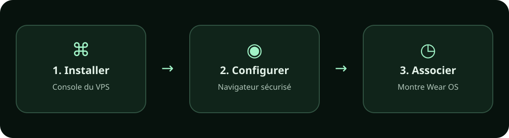
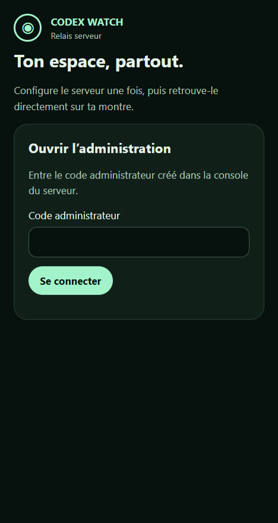
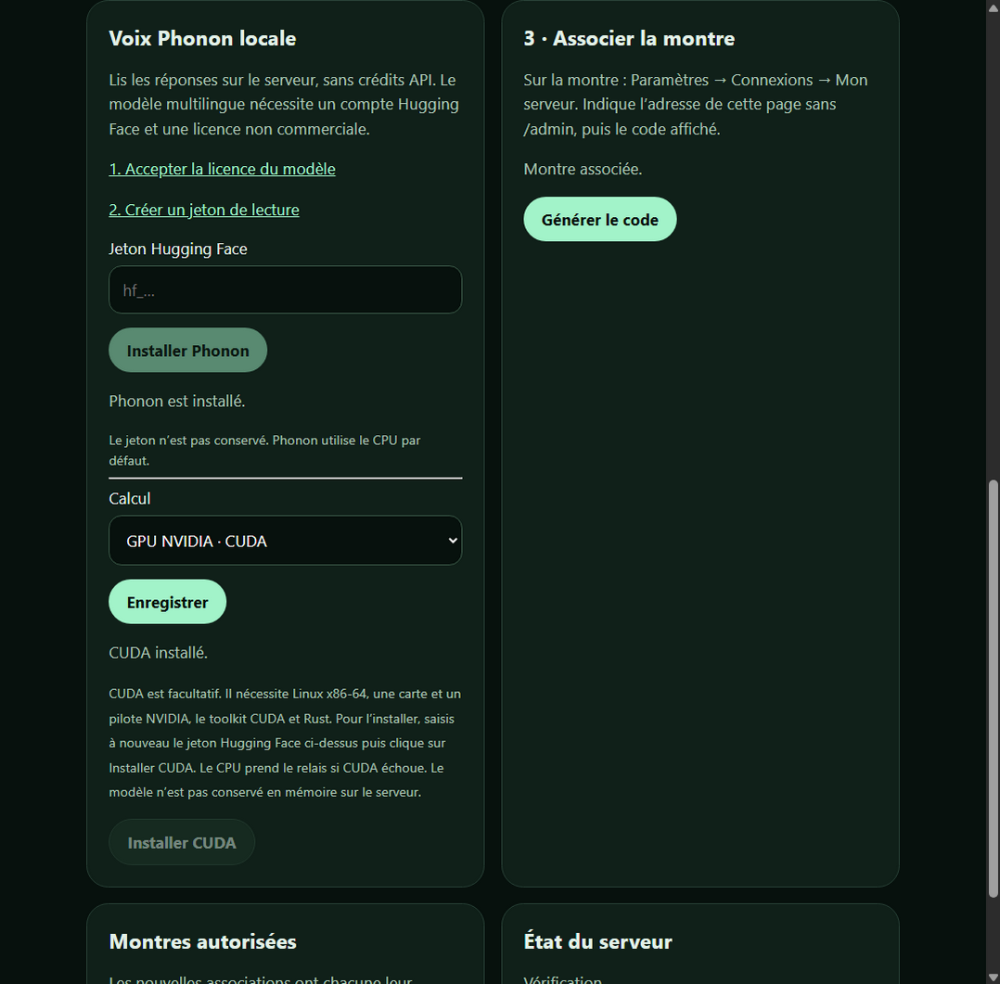

# Installer Codex Watch sur un VPS

Ce parcours relie la montre directement à ton serveur. Il n’utilise pas l’application relais Windows. Il te faut un VPS Linux avec systemd, un accès à sa console ou en SSH, un navigateur et une montre Wear OS avec Codex Watch installé. Une console SSH peut aussi être ouverte depuis un téléphone ; certains hébergeurs proposent une console dans leur espace client.



Télécharge l’APK depuis la [page des releases](https://github.com/evrardt/codex-watch/releases) et installe-le sur la montre en suivant [les étapes depuis un téléphone](../README.md#3-installer-lapk-sur-la-montre-depuis-le-téléphone). Récupère également les sources du même dépôt sur le VPS. Ne télécharge pas un fichier provenant d’une source que tu ne connais pas.

## 1. Préparer le serveur

1. Connecte-toi à la console du VPS avec un **utilisateur ordinaire**, pas root. Il doit disposer de Node.js 22 ou plus récent, de npm et d’une session systemd utilisateur. Voir les [téléchargements Node.js](https://nodejs.org/en/download) et la documentation de ton hébergeur.
2. Récupère sur le serveur les sources du dépôt Codex Watch, puis ouvre leur dossier `bridge` dans la console :

   ```sh
   git clone https://github.com/evrardt/codex-watch.git
   cd codex-watch/bridge
   node vps-setup.mjs install
   ```

   L’installateur crée un relais dans `~/.local/share/codex-watch-vps`, installe ses dépendances et Codex, puis active son service utilisateur. Il refuse d’écraser une installation existante. Si l’installation est interrompue, vérifie les fichiers créés avant de recommencer : elle ne les supprime pas automatiquement.
3. Pour garder le service utilisateur actif après déconnexion et redémarrage du VPS, un administrateur doit activer le *linger* pour cet utilisateur, par exemple `sudo loginctl enable-linger NOM_UTILISATEUR`. Sur un hébergement sans systemd utilisateur, ce parcours automatique ne fonctionne pas : une adaptation manuelle est nécessaire.

## 2. Donner une adresse HTTPS au relais

1. Installe [Tailscale sur Linux](https://tailscale.com/download/linux) et connecte le VPS à ton réseau Tailscale. L’administrateur du réseau peut devoir autoriser HTTPS et Funnel.
2. Dans la console du VPS, active l’accès HTTPS public vers le relais :

   ```sh
   sudo tailscale funnel --bg --https=8443 http://127.0.0.1:18787
   ```

   Utilise un autre port HTTPS pris en charge si `8443` est déjà utilisé. Tailscale affiche une adresse ressemblant à `https://nom-du-serveur.exemple.ts.net:8443` : conserve **ton adresse réelle**. Funnel rend le relais joignable sur Internet ; la montre reste protégée par son jeton et l’administration par un code distinct. Voir la [documentation Tailscale Funnel](https://tailscale.com/docs/features/tailscale-funnel).
3. Enregistre cette adresse, sans chemin final, puis redémarre le relais :

   ```sh
   node ~/.local/share/codex-watch-vps/bridge/vps-setup.mjs url https://TON-ADRESSE-TAILSCALE:8443
   systemctl --user restart codex-watch-vps.service
   ```

## 3. Choisir son mot de passe dans le navigateur

La commande `url` de l’étape précédente affiche un **lien privé de première installation**, valable 30 minutes. Après le redémarrage du relais, ouvre ce lien dans le navigateur et choisis ton mot de passe. Ne partage pas ce lien : il protège la première configuration contre une prise de contrôle par une autre personne. Il ne sert qu’une fois. S’il expire, relance la commande `url` de l’étape précédente pour obtenir un nouveau lien.

Pour les connexions suivantes, ouvre ton adresse HTTPS en ajoutant `/admin` et saisis ton mot de passe. La page ne demande pas le jeton de la montre.



## 4. Configurer Codex, le Chat et la montre

1. Dans l’interface, touche **Connecter Codex**. Ouvre le lien OpenAI proposé, saisis le code temporaire affiché et valide la connexion de ton compte. Si le relais ne prend pas immédiatement en compte la connexion, redémarre-le avec `systemctl --user restart codex-watch-vps.service`.
2. Pour utiliser le bouton **Chat**, crée ou choisis une [clé API OpenAI](https://platform.openai.com/api-keys), puis saisis-la dans **Configurer le Chat**. La page indique si une clé est enregistrée et affiche ses quatre derniers caractères ; **Afficher** permet de la consulter temporairement. Elle reste sur le serveur et n’est pas envoyée à la montre. Les crédits et la facturation de l’organisation API de cette clé s’appliquent. Vérifie le solde et les limites sur OpenAI Platform : le budget audio ne limite pas ce Chat. Cette étape est facultative si tu veux uniquement Codex.
3. Pour utiliser aussi le Live et la voix OpenAI sur le VPS, active **Live et voix**, choisis un budget mensuel en dollars puis enregistre. Cette option utilise la même clé API ; elle reste désactivée tant que tu ne la choisis pas. Le plafond audio ne couvre pas le Chat.
4. Touche **Générer le code** dans la section d’association. Sur la montre, ouvre **Codex Watch → Lier serveur**, ou **Paramètres → Connexions → Mon serveur** si elle est déjà configurée. Saisis ton adresse HTTPS **sans `/admin`**, puis le code à six chiffres. La page affiche **Montre associée** après confirmation. Le code expire au bout de deux minutes ; génère-en un autre si nécessaire.
5. Ouvre **Chat** ou **Codex** sur la montre. Si seul le VPS est associé, il est sélectionné automatiquement. Si le PC et le VPS sont tous deux associés, le bouton en bas de l’accueil permet de basculer entre eux.

Dans **Chat**, choisis le modèle API voulu. L’administration affiche une estimation locale des dépenses du mois pour les réponses dont elle connaît l’usage ; elle ne comprend pas nécessairement toutes les requêtes, les taxes ou les autres applications. Elle ne constitue pas un plafond de facturation. Consulte OpenAI Platform pour les montants et limites officiels. Le budget audio est séparé.

Dans **Montres autorisées**, les nouvelles associations confirmées apparaissent individuellement et peuvent être retirées sans retirer les autres. Les associations anciennes utilisent un jeton partagé : même après une nouvelle association individuelle, cet ancien jeton reste valide jusqu’à sa rotation générale. Pour invalider les anciens accès, il faut remplacer le jeton partagé et réassocier les appareils qui l’utilisaient ; ne réalise cette opération que lorsque tu peux reconnecter ces appareils.

Le dossier `~/.local/share/codex-watch-vps/projects` est le projet Codex initial du VPS. Le Chat utilise son propre historique sur le serveur et ne récupère pas les conversations, projets ou plugins du site ChatGPT. Le Live utilise la clé du serveur seulement si tu l’actives dans **Live et voix** ; son budget est distinct de celui du Chat.

### Recevoir les notifications en veille

Les alertes directes fonctionnent sans service supplémentaire. Pour améliorer leur réception en veille ou en 4G, ouvre **Notifications Firebase** dans l’administration et importe les deux fichiers de ton projet. Le [guide illustré des notifications](NOTIFICATIONS.md) explique comment les obtenir et tester l’alerte. La clé du compte de service est alors conservée sur ce serveur : choisis une clé que tu acceptes d’y enregistrer.

### Ajouter la voix Phonon

Dans l’interface web du VPS, ouvre **Voix Phonon locale**. Accepte d’abord les conditions du [modèle multilingue sur Hugging Face](https://huggingface.co/gradium/phonon-40m-multilingual), crée un jeton de lecture depuis ton compte, puis saisis-le et touche **Installer**. Le jeton sert au téléchargement et n’est pas conservé. Une fois l’installation terminée, choisis Phonon dans les réglages de voix sur la montre. Le modèle est sous licence **CC BY-NC 4.0**, réservée aux usages non commerciaux.

L’installation initiale utilise le processeur : Linux x86-64-v3 ou ARM64 et glibc 2.35 minimum sont nécessaires. Pour un serveur Linux x86-64 équipé d’un GPU NVIDIA, installe d’abord le pilote, le [toolkit CUDA](https://developer.nvidia.com/cuda-downloads) et [Rust avec Cargo](https://www.rust-lang.org/tools/install). Dans **Voix Phonon locale**, saisis à nouveau le jeton et clique sur **Installer CUDA**. La compilation et le téléchargement peuvent prendre plusieurs minutes et utiliser plusieurs Go. Sélectionne ensuite **GPU NVIDIA · CUDA** dans **Calcul** puis enregistre. En cas d’échec de CUDA, le relais utilise le CPU ; le statut indique le moteur de la dernière lecture. Le modèle est rechargé à chaque lecture. Les GPU AMD et Intel ne sont pas encore pris en charge par cette option. Le Live continue d’utiliser sa propre voix et son propre budget.



## Dépannage

- **La page ne s’ouvre pas :** vérifie `systemctl --user status codex-watch-vps.service` et `tailscale funnel status`. L’adresse saisie dans la commande `url` doit correspondre exactement à celle utilisée par le navigateur, y compris le port.
- **Mot de passe perdu :** depuis la console du serveur, lance `node ~/.local/share/codex-watch-vps/bridge/vps-setup.mjs reset-admin`. Ouvre le lien privé affiché et choisis un nouveau mot de passe ; il expire après 30 minutes et fonctionne une seule fois. L’ancien mot de passe reste valable jusqu’à la confirmation du nouveau. Ne partage pas le lien.
- **La montre ne s’associe pas :** vérifie l’adresse HTTPS sans `/admin`, génère un nouveau code et assure-toi que la montre a une connexion Internet.
- **Le Chat ne répond pas :** vérifie les crédits et l’accès au modèle dans le projet API de la clé. Les erreurs sont indiquées dans la conversation.
- **Codex ne peut pas travailler :** vérifie que le compte est connecté et que le projet existe ; le serveur n’obtient pas automatiquement de droits administrateur.
