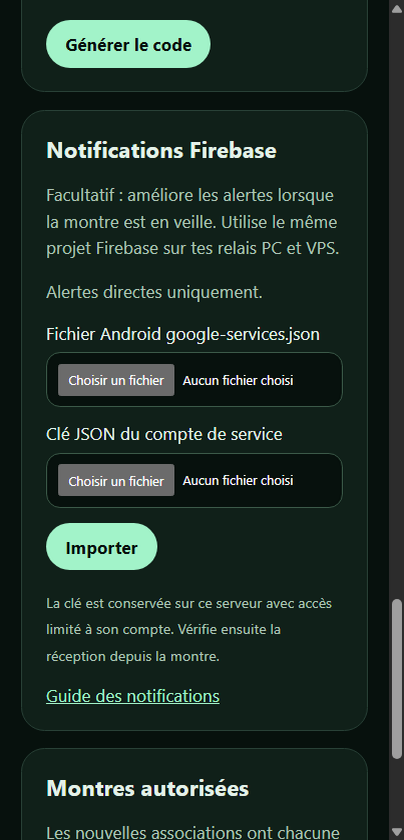

# Notifications avec Firebase

Les alertes directes de Codex Watch fonctionnent sans compte Google tant que la liaison directe reste disponible. Pour améliorer la réception lorsque la montre est en veille ou utilise la 4G, tu peux configurer Firebase Cloud Messaging (FCM). Ce réglage est facultatif et demande une préparation unique du projet Google.

## Créer les deux fichiers

1. Dans la [console Firebase](https://console.firebase.google.com/), crée un projet ou ouvre ton projet existant. Ajoute une application Android avec le nom de package **`fr.thomas.codexwatch`**. Télécharge son fichier **`google-services.json`**. Consulte au besoin les [instructions officielles](https://firebase.google.com/docs/android/setup).
2. Dans le même projet, ouvre la [bibliothèque des API Google Cloud](https://console.cloud.google.com/apis/library/fcm.googleapis.com) et active **Firebase Cloud Messaging API** si elle ne l’est pas déjà. Vérifie le projet sélectionné en haut de la page.
3. Dans [IAM et administration → Comptes de service](https://console.cloud.google.com/iam-admin/serviceaccounts), crée un compte dédié à l’envoi des notifications. Accorde-lui les droits d’envoi FCM pour ce seul projet. Un rôle personnalisé contenant `cloudmessaging.messages.create` limite les droits à l’envoi ; le rôle prédéfini **Firebase Cloud Messaging API Admin** est plus simple mais donne aussi d’autres droits de gestion FCM.
4. Ouvre ce compte de service, onglet **Clés → Ajouter une clé → Créer une clé → JSON**, et télécharge la clé. C’est un secret : ne la publie jamais et ne la partage pas. Certaines organisations interdisent la création de clés ; dans ce cas, demande à leur administrateur ou utilise les alertes directes.

## Importer sur le PC

1. Dans **Codex Watch Relay → Notifications**, clique sur **Importer les fichiers**.
2. Choisis d’abord `google-services.json`, puis le fichier JSON de la clé du compte de service. Les deux doivent provenir du même projet. Le relais vérifie leur contenu et chiffre la clé avec le coffre Windows du compte courant.
3. Redémarre le relais. Vérifie que Firebase est indiqué comme chargé, puis sur la montre active les notifications et utilise **Tester une alerte**. Le mode silencieux ou « Ne pas déranger » peut empêcher le son et la vibration.

Les jetons temporaires Google nécessaires à l’envoi sont renouvelés automatiquement par le relais : il n’est pas nécessaire de se reconnecter chaque jour. Le fichier de clé téléchargé reste une copie sensible ; conserve-le en sécurité ou supprime cette copie après avoir vérifié l’import. Pour révoquer une clé compromise, supprime-la dans la console Google, crées-en une nouvelle et réimporte-la.

## Importer sur le VPS

1. Ouvre l’administration HTTPS de ton serveur dans le navigateur et connecte-toi avec ton mot de passe administrateur.
2. Dans **Notifications Firebase**, choisis `google-services.json`, puis la clé JSON du compte de service du même projet. Clique sur **Importer**.
3. L’état indique que la configuration est chargée. Sur la montre, sélectionne **Mon serveur**, active les notifications, puis touche **Tester une alerte**.

La clé est transférée à ton propre serveur via son adresse HTTPS et conservée dans son dossier privé, accessible au compte du relais. Les jetons d’accès temporaires sont renouvelés automatiquement. Si tu utilises également un relais PC, utilise **le même projet Firebase** sur les deux. Pour éviter une configuration incompatible avec une montre déjà associée, l’interface refuse de remplacer un projet Firebase existant par un autre.

La mention « Firebase chargé » confirme que le relais a chargé ses paramètres, mais pas qu’une alerte est parvenue à la montre : effectue toujours le test. Pour les détails sur l’authentification, consulte la [documentation FCM officielle](https://firebase.google.com/docs/cloud-messaging/send/v1-api).
